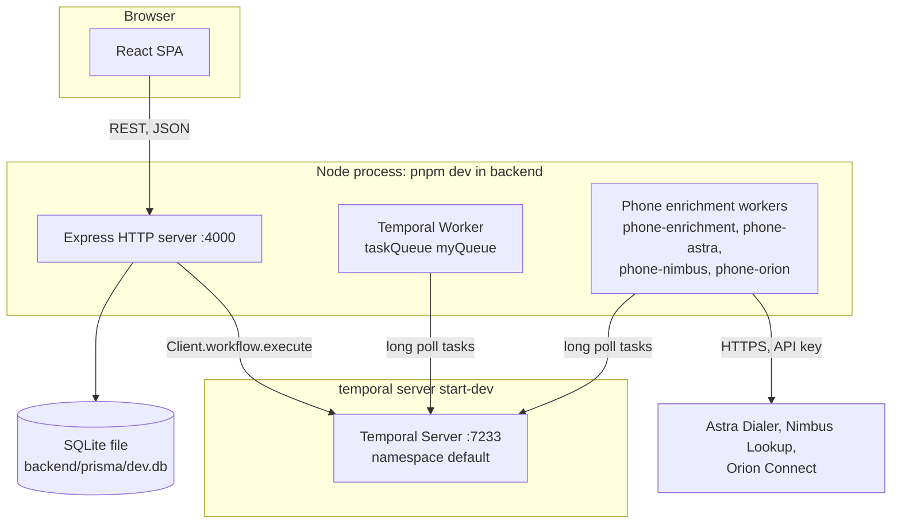

# 01 - System Overview

## Context

TinyEnginy is a condensed version of the Enginy product, used as a take-home exercise.
It manages sales leads: people with a name, email, job title, company, and country.
The product surface is a single page with a leads table, a CSV import modal, and an "Enrich" menu.

## Repository layout

```text
.
├── backend/                  Express API + Temporal worker (CommonJS, ts-node)
│   ├── prisma/
│   │   ├── schema.prisma     Single `lead` model, SQLite datasource
│   │   ├── migrations/       4 migrations, 2024-07 to 2025-09
│   │   └── dev.db            Committed SQLite database file
│   └── src/
│       ├── index.ts          Entry point: server and worker bootstrap
│       ├── app.ts            createApp: CORS and all HTTP routes
│       ├── worker.ts         Temporal worker factory
│       ├── leads/            field registry, value rules, import plan, lead view (+ unit tests)
│       ├── utils/            messageGenerator, countryCode (+ unit tests)
│       └── workflows/        verifyEmailWorkflow + activities
├── frontend/                 React SPA (ESM, Vite)
│   └── src/
│       ├── main.tsx, App.tsx, Providers.tsx
│       ├── components/       LeadsList, CsvImportModal, MessageTemplateModal
│       ├── api/              Typed endpoint factory, leads module, request/response types
│       └── utils/            axios instance, csvParser (+ unit tests)
├── docs/                     Sample CSVs and UI wireframes
├── README.md                 Exercise brief and task list
├── HOW_TO_SOLVE.md           Working method (SDD + TDD with OpenSpec)
└── AGENTS.md                 Agent working rules
```

There is no root `package.json`, no workspace configuration, and no shared types package.
Each package has its own lockfile, Prettier config, and Vitest config.

## Runtime topology

Three processes must run locally.



- The Express server and the Temporal worker share one Node process, started from `backend/src/index.ts`.
- If the worker fails to connect to Temporal, the whole process exits, so the API cannot run without Temporal.
- The API shares one lazily created Temporal client across requests, and starts verification and phone enrichment workflows without waiting for them.
- The phone enrichment workers start in the same process and only log an error when a provider key is missing, so the API still runs without them.
- The API port `4000` is hardcoded, and the Temporal address, namespace, and task queue default to `localhost:7233`, `default`, and `myQueue`.
- The frontend reads the API base URL from `VITE_API_URL` in `frontend/.env`.

## Technology stack

| Layer | Technology | Version range |
| --- | --- | --- |
| Runtime | Node.js | 22 (`.nvmrc`) |
| Package manager | pnpm | lockfile per package |
| HTTP server | Express | ^5.1 |
| ORM | Prisma Client | ^6.15 |
| Database | SQLite | file `dev.db` |
| Workflow engine | Temporal TypeScript SDK | ^1.13 |
| Backend dev runner | nodemon + ts-node | - |
| UI library | React | ^18.3 |
| Build tool | Vite with SWC React plugin | ^7.3 |
| Styling | Tailwind CSS (Vite plugin) | ^4.1 |
| Server state | TanStack Query | ^5.86 |
| HTTP client | axios | ^1.15 |
| CSV parsing | PapaParse | ^5.5 |
| Notifications | react-hot-toast | ^2.6 |
| Tests | Vitest (node in backend, jsdom in frontend) | ^3.2 |
| Lint | ESLint 9 flat config with `typescript-eslint` (frontend only) | ^9.34 |

## Configuration

| Setting | Location | Notes |
| --- | --- | --- |
| Database URL | `backend/prisma/schema.prisma` | Hardcoded `file:./dev.db`. |
| Backend environment | `backend/.env`, documented in `backend/.env.sample` | Loaded at startup when present, with shell variables taking precedence; the file is gitignored. |
| Phone providers | `ASTRA_API_KEY`, `NIMBUS_API_KEY`, `ORION_API_KEY`, `*_BASE_URL`, `PHONE_PROVIDER_ORDER`, `PHONE_<PROVIDER>_MAX_PER_SECOND` | Validated by `backend/src/phoneEnrichment/config.ts` before the phone workers start. |
| API port | `backend/src/index.ts` | Hardcoded `4000`. |
| Temporal connection | `backend/src/temporal/config.ts` | `TEMPORAL_ADDRESS`, `TEMPORAL_NAMESPACE`, and `TEMPORAL_TASK_QUEUE`, with local defaults. |
| API base URL | `frontend/.env` | `VITE_API_URL`, validated at module load in `frontend/src/utils/axios.ts`. |
| CORS | `backend/src/app.ts` | Hand-written middleware allowing every origin. |

## Local development

The README documents the setup.
The backend needs `pnpm install`, `pnpm migrate:dev`, `pnpm gen:prisma`, a running `temporal server start-dev`, and `pnpm run dev`.
The frontend needs `pnpm install` and `pnpm run dev`.

## Quality gates at analysis time

These results were measured on a clean checkout of `67c2047` with dependencies installed from the lockfiles.

| Check | Command | Result |
| --- | --- | --- |
| Backend unit tests | `pnpm exec vitest run` | 24 passed |
| Backend type check | `pnpm exec tsc --noEmit -p .` | Passes |
| Backend lint | none | No lint script or ESLint config exists |
| Frontend unit tests | `pnpm exec vitest run` | 19 passed |
| Frontend type check | `pnpm exec tsc -b` | Fails with TS2741 in `src/api/mutations/useApiMutation.ts` |
| Frontend lint | `pnpm lint` | Fails, because ESLint 9 does not load the legacy `.eslintrc.cjs` |

Because the frontend `build` script runs `tsc -b` first, `pnpm build` in the frontend also fails.
The `test` scripts run `vitest` without `run`, so they start in watch mode in an interactive terminal.
There is no CI configuration, no end-to-end test suite, and no API or integration tests.

### Current state

The table above is a snapshot from the initial analysis.
The [fix-csv-country-codes](../../openspec/changes/archive/2026-10-30-fix-csv-country-codes/proposal.md) change restored the frontend type check, build, and lint, added API tests for the backend, and added component tests for the frontend.
The backend now has a `typecheck` script that also covers test files.
The backend still has no lint configuration, and there is still no CI pipeline.
