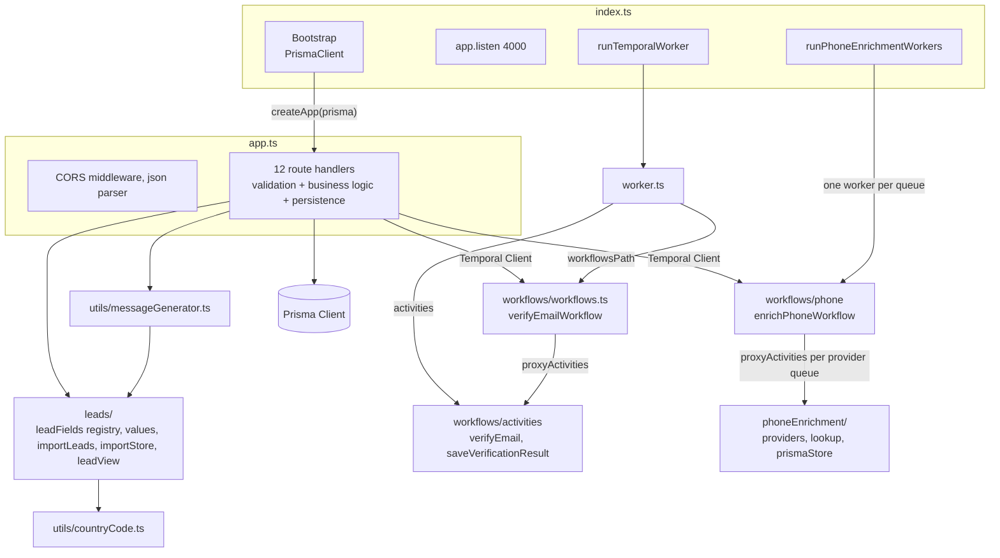
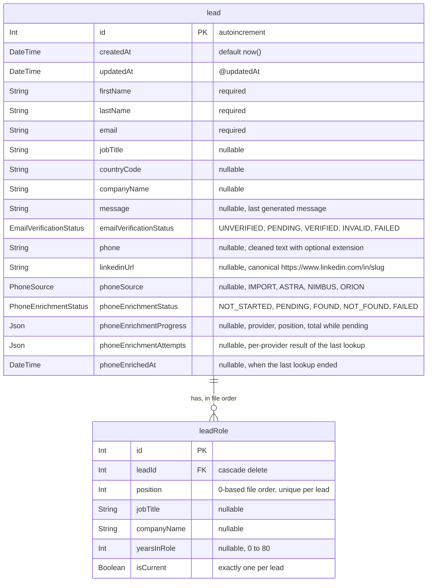
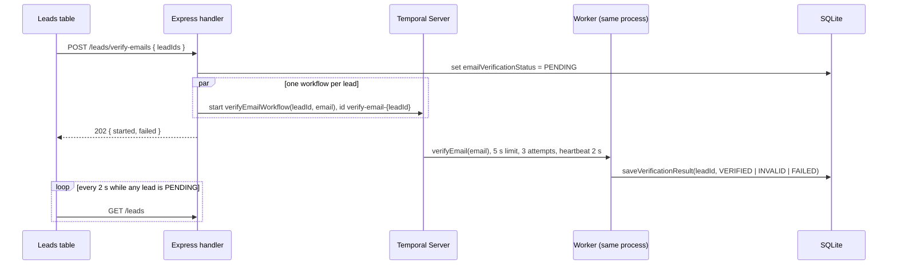
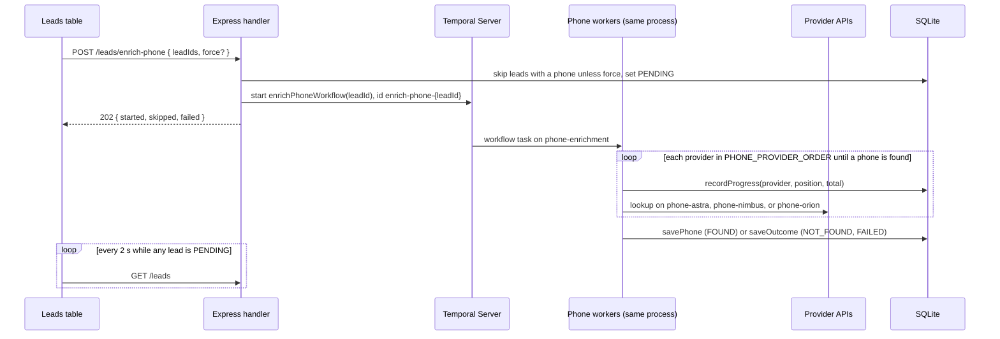

# 02 - Backend

## Structure

The backend is a CommonJS TypeScript package run by `nodemon` and `ts-node` in development.
Almost all logic lives in `backend/src/app.ts`, which mixes several responsibilities in one file.



`backend/src/index.ts` is only the entry point: it creates the Prisma client, passes it to `createApp` from `backend/src/app.ts`, listens on port 4000, and starts the email verification worker and the phone enrichment workers.
It imports `backend/src/loadEnv.ts` first, which loads `backend/.env` when present.
`createApp` builds the routes without side effects, so tests can run them against their own database.

There is no layering between HTTP, domain, and persistence.
Each route handler parses the body, validates it by hand, calls Prisma directly, and shapes the response.

## Data model

The database has a lead table and its role history.



- `lead.jobTitle` and `lead.companyName` are copies of the current role, written in the same create, so existing reads keep working.
- Years in role and years at company are not stored on the lead: `toLeadView` in `backend/src/leads/leadView.ts` derives them from the roles on every read.

- The Prisma model name is lowercase `lead`, which is unusual for Prisma conventions.
- There are no indexes or unique constraints beyond the primary key and `leadRole(leadId, position)`; the import prevents email duplicates, the database does not.
- `message` stores only the latest generated message, so history is lost on every generation.
- `emailVerificationStatus` is an enum that defaults to `UNVERIFIED`, and `PENDING` drives the table's polling.
- `phoneEnrichmentStatus` defaults to `NOT_STARTED`, and `PENDING` also drives the table's polling.
- `phoneSource` records where the current phone came from: `IMPORT` for CSV phones, or the provider that found it.

### Migrations

| Migration | Change |
| --- | --- |
| `20240725105048_` | Creates `lead` with optional `lastName` and `email`. |
| `20250904113722_add_message_field` | Adds `message`. |
| `20250904134219_make_last_name_email_required` | Rebuilds the table to make `lastName` and `email` required. |
| `20250905104559_add_email_verified_column` | Adds `emailVerified` with default `NULL`. |
| `20261030090000_replace_email_verified_with_status` | Replaces `emailVerified` with `emailVerificationStatus`, mapping true to `VERIFIED`, false to `INVALID`, and null to `UNVERIFIED`. |
| `20261030100000_add_lead_profile_and_roles` | Adds `phone` and `linkedinUrl`, creates `leadRole`, and gives every existing lead one current role copied from its job title and company. |
| `20261030110000_add_phone_enrichment` | Adds the phone enrichment fields, and marks existing phones as `IMPORT`. |

The datasource URL is hardcoded in `schema.prisma` and the `dev.db` file is committed, so local data is shared through git.

## HTTP API

All endpoints accept and return JSON.
None are authenticated, rate limited, or paginated.

| Method | Path | Purpose | Request body | Response |
| --- | --- | --- | --- | --- |
| `POST` | `/leads` | Create one lead | `{ name, lastName, email }` | Created lead |
| `GET` | `/leads/:id` | Read one lead | - | Lead, or `null` with status 200 when missing |
| `GET` | `/leads` | List all leads | - | Array of leads with `roles`, `yearsInRole`, and `yearsAtCompany`, unpaginated |
| `GET` | `/leads/fields` | Describe the lead fields | - | `{ fields: [{ key, label, group, type, templatable, column }] }` |
| `PATCH` | `/leads/:id` | Update name and email | `{ name, email }` | Updated lead |
| `DELETE` | `/leads/:id` | Delete one lead | - | Empty |
| `DELETE` | `/leads` | Delete many leads | `{ ids: number[] }` | `{ deletedCount }` |
| `POST` | `/leads/generate-messages` | Render a template for many leads | `{ leadIds, template }` | `{ success, generatedCount, errors[] }` |
| `POST` | `/leads/import/preview` | Show what an import of these CSV rows would store | `{ rows[] }` with headers as written, at most 5000 | `{ totalRows, leads[], invalidRows[] }` |
| `POST` | `/leads/bulk` | Import CSV rows | `{ rows[] }` with headers as written, at most 5000 | `{ success, importedCount, duplicatesSkipped, invalidRows, errors[] }` |
| `POST` | `/leads/verify-emails` | Start background email verification | `{ leadIds }`, at most 500 positive integers | `202 { started[], failed[{ leadId, error }] }`, or 404 when no id matches |
| `POST` | `/leads/enrich-phone` | Start background phone lookups | `{ leadIds, force? }`, at most 500 positive integers | `202 { started[], skipped[{ leadId, reason }], failed[{ leadId, error }] }`, or 404 when no id matches |

### Handler patterns

- Batch endpoints return HTTP 200 with a partial-success envelope, listing per-lead errors next to the success count.
- Batch endpoints process leads one by one with `await` inside a `for` loop, so latency grows linearly with the number of leads.
- Batch writes are not wrapped in a transaction, so a crash leaves a partially applied batch.
- Validation is hand-written per route with `typeof` checks and repeated error messages.
- IDs are converted with `Number(id)` without checking for `NaN`.
- The single-lead routes have no `try/catch` and rely on Express 5 forwarding rejected promises to the default error handler.
- The create and update routes read a field called `name`, while the frontend contract sends `firstName`.

### Bulk import logic

`buildImport` in `backend/src/leads/importLeads.ts` turns raw CSV rows into an import plan, as described in [decision 0004](../decisions/0004-backend-computes-the-import-plan.md).
`POST /leads/import/preview` returns the plan and `POST /leads/bulk` executes it, so they cannot disagree.

1. Map each header to a registry field by lowercasing it and keeping only letters, so `Years In Role` and `phone` both resolve.
2. Skip blank rows, and reject rows without first name, last name, or a well-formed email, with reasons.
3. Group the remaining rows by lowercased email; each row becomes one role of that person, and identical roles are merged so years are not counted twice.
4. Take person-level values (names, phone, LinkedIn, country) from the first non-blank row, and note rows that disagree.
5. Mark the current role: the last row with `isCurrentRole`, else the last row in file order.
6. Mark people whose email already exists, ignoring case, as duplicates to skip.

`executeImport` in `backend/src/leads/importStore.ts` creates each new person with their roles in one write.
Every value is validated through the registry; an invalid phone, LinkedIn URL, years value, or country is stored blank with a preview note, and the row is still imported.

### Country code normalization

`normalizeCountryCode` in `backend/src/utils/countryCode.ts` is the single place that decides which country a lead gets.
It was introduced by the [fix-csv-country-codes](../../openspec/changes/archive/2026-10-30-fix-csv-country-codes/design.md) change, and the reasoning is in [decision 0001](../decisions/0001-backend-owns-country-code-conversion.md).

```text
input --> trim --> empty?                     --> null (empty)
               --> UK or EL alias?            --> GB or GR
               --> 2 letters, valid alpha-2?  --> uppercase code
               --> 3 letters, valid alpha-3?  --> alpha-2
               --> 1 to 3 digits, assigned?   --> alpha-2
               --> English name, one match?   --> alpha-2
               --> otherwise                  --> null (cleared)
```

- It uses `i18n-iso-countries` data, with its own name index so that names shared by two countries, such as "Congo", resolve to `null` instead of a guess.
- The import plan, through the registry's country rule, and the `pnpm db:normalize-countries` backfill command both use it.
- The backfill defaults to a dry run and needs `--apply` to write.

### Message generation

`generateMessageFromTemplate` in `backend/src/utils/messageGenerator.ts` renders a template for one lead view.

- It finds `{word}` placeholders and accepts exactly the registry fields marked `templatable`, so a new field becomes usable without touching the generator.
- It throws `Unknown field in template` for any other name, and `Missing required field` when the lead's value is `null`, `undefined`, or empty; the route then skips that lead and reports it.
- It renders numbers as text, so `{yearsAtCompany}` works, and it inserts values literally, so `$&` in a value is not a replacement pattern.
- The route loads leads with their roles and passes `toLeadView` results, so derived values such as years at company are available.

## Temporal integration

Email verification follows the start-then-observe pattern from [decision 0002](../decisions/0002-start-then-observe-background-work.md), introduced by the [fix-email-verification-stall](../../openspec/changes/archive/2026-10-30-fix-email-verification-stall/design.md) change.



- `backend/src/emailVerification/start.ts` starts workflows through one lazily created client from `backend/src/temporal/client.ts`, with `USE_EXISTING` and `ALLOW_DUPLICATE`, so a repeated start joins the running workflow.
- `backend/src/temporal/config.ts` holds the address, namespace, and task queue, read from `TEMPORAL_ADDRESS`, `TEMPORAL_NAMESPACE`, and `TEMPORAL_TASK_QUEUE` with local defaults.
- The worker builds its activities with `createActivities(prisma)`, so `saveVerificationResult` can write the outcome.
- `verifyEmail` allows three attempts of five seconds with one and two second backoff, so a check that never answers ends `FAILED` in about 18 seconds.
- The workflow catches the final activity failure and records `FAILED`, and it has no execution timeout, because a timed-out workflow could not record anything.
- The activity is a mock: emails containing `john.doe` or `+` fail verification, and emails containing `jane.smith` wait 20 seconds while heartbeating, so timed-out attempts are cancelled instead of sleeping on.
- Workflow tests use `@temporalio/testing` with time skipping, and API tests run the endpoint against the same test server.

Before the fix, a one-second timeout, a 20-second activity, and unlimited retries produced a workflow that never completed, inside a request that waited for it ([FIX-002](../fixes/FIX-002-email-verification-stall.md)).

### Phone enrichment

Phone lookups follow the same start-then-observe pattern, introduced by the [enrich-lead-phone](../../openspec/changes/archive/2026-10-30-enrich-lead-phone/design.md) change.



- Providers implement one skip, call, and normalize contract ([decision 0005](../decisions/0005-phone-provider-abstraction.md)): Astra needs an email, Nimbus also a job title, and Orion a business email domain.
- The workflow runs on `phone-enrichment`, and each provider's lookup runs on its own task queue with an optional `PHONE_<PROVIDER>_MAX_PER_SECOND` limit, enforced by the server across workers and by spacing calls within the process ([decision 0006](../decisions/0006-one-task-queue-per-phone-provider.md)).
- Lookups allow three attempts of 5, 8, and 10 seconds per provider; 400, 401, and 403 are not retried, and a 429 waits for its `Retry-After`.
- A provider that errors is recorded and the next provider runs; the lead ends `FAILED` only when no phone was found and some provider errored.
- Found numbers are stored as E.164 with `libphonenumber-js` when valid, and the store activities write only phone enrichment columns, so email verification can run on the same lead.
- `runPhoneEnrichmentWorkers` refuses to start, naming the variable, when a provider key is missing, and the API keeps running without them.

## Cross-cutting concerns

| Concern | Current state |
| --- | --- |
| Validation | Hand-written per route, no schema library. |
| Error handling | Per-route `try/catch` with `console.error`, no central error middleware. |
| Logging | `console.log` and `console.error` only. |
| Security | Wildcard CORS, no authentication, no rate limiting, no request size limit beyond the Express default. |
| Configuration | Hardcoded ports, addresses, and database URL. |
| Shutdown | No graceful shutdown for HTTP server, Prisma, or worker. |
| Testing | Unit tests for the value rules, the import plan, the generator, and `countryCode`; migration tests through `src/test/migrations.ts`; and API tests with `supertest` against `createApp` from `backend/src/app.ts`. Each test file gets its own copy of a SQLite database migrated from the real migrations, built in `src/test/globalSetup.ts`. |
