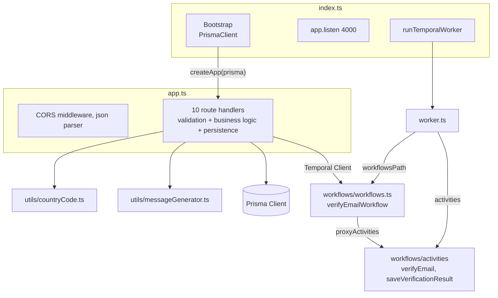
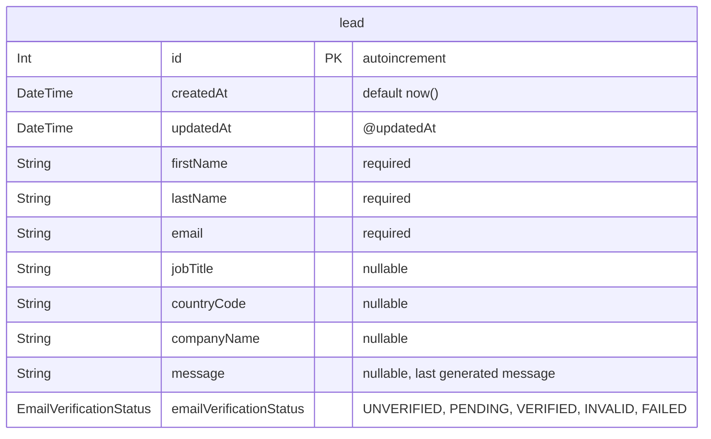
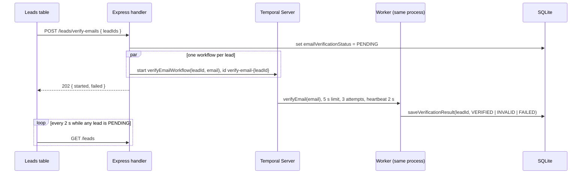

# 02 - Backend

## Structure

The backend is a CommonJS TypeScript package run by `nodemon` and `ts-node` in development.
Almost all logic lives in `backend/src/app.ts`, which mixes several responsibilities in one file.



`backend/src/index.ts` is only the entry point: it creates the Prisma client, passes it to `createApp` from `backend/src/app.ts`, listens on port 4000, and starts the worker.
`createApp` builds the routes without side effects, so tests can run them against their own database.

There is no layering between HTTP, domain, and persistence.
Each route handler parses the body, validates it by hand, calls Prisma directly, and shapes the response.

## Data model

The database has a single table.



- The Prisma model name is lowercase `lead`, which is unusual for Prisma conventions.
- There are no indexes or unique constraints beyond the primary key, so email duplicates are allowed.
- `message` stores only the latest generated message, so history is lost on every generation.
- `emailVerificationStatus` is an enum that defaults to `UNVERIFIED`, and `PENDING` drives the table's polling.
- Phone enrichment state has no representation in the model yet, and is planned in the `enrich-lead-phone` change.
- The sample CSVs already carry `yearsInRole` and `phoneNumber` columns that the model does not have.

### Migrations

| Migration | Change |
| --- | --- |
| `20240725105048_` | Creates `lead` with optional `lastName` and `email`. |
| `20250904113722_add_message_field` | Adds `message`. |
| `20250904134219_make_last_name_email_required` | Rebuilds the table to make `lastName` and `email` required. |
| `20250905104559_add_email_verified_column` | Adds `emailVerified` with default `NULL`. |
| `20261030090000_replace_email_verified_with_status` | Replaces `emailVerified` with `emailVerificationStatus`, mapping true to `VERIFIED`, false to `INVALID`, and null to `UNVERIFIED`. |

The datasource URL is hardcoded in `schema.prisma` and the `dev.db` file is committed, so local data is shared through git.

## HTTP API

All endpoints accept and return JSON.
None are authenticated, rate limited, or paginated.

| Method | Path | Purpose | Request body | Response |
| --- | --- | --- | --- | --- |
| `POST` | `/leads` | Create one lead | `{ name, lastName, email }` | Created lead |
| `GET` | `/leads/:id` | Read one lead | - | Lead, or `null` with status 200 when missing |
| `GET` | `/leads` | List all leads | - | Array of leads, unpaginated |
| `PATCH` | `/leads/:id` | Update name and email | `{ name, email }` | Updated lead |
| `DELETE` | `/leads/:id` | Delete one lead | - | Empty |
| `DELETE` | `/leads` | Delete many leads | `{ ids: number[] }` | `{ deletedCount }` |
| `POST` | `/leads/generate-messages` | Render a template for many leads | `{ leadIds, template }` | `{ success, generatedCount, errors[] }` |
| `POST` | `/leads/bulk` | Import many leads from parsed CSV | `{ leads[] }` | `{ success, importedCount, duplicatesSkipped, invalidLeads, errors[] }` |
| `POST` | `/leads/country-codes/normalize` | Preview how country values will be stored | `{ values: string[] }`, at most 1000 values of at most 100 characters | `{ results: [{ value, code, outcome }] }` |
| `POST` | `/leads/verify-emails` | Start background email verification | `{ leadIds }`, at most 500 positive integers | `202 { started[], failed[{ leadId, error }] }`, or 404 when no id matches |

### Handler patterns

- Batch endpoints return HTTP 200 with a partial-success envelope, listing per-lead errors next to the success count.
- Batch endpoints process leads one by one with `await` inside a `for` loop, so latency grows linearly with the number of leads.
- Batch writes are not wrapped in a transaction, so a crash leaves a partially applied batch.
- Validation is hand-written per route with `typeof` checks and repeated error messages.
- IDs are converted with `Number(id)` without checking for `NaN`.
- The single-lead routes have no `try/catch` and rely on Express 5 forwarding rejected promises to the default error handler.
- The create and update routes read a field called `name`, while the frontend contract sends `firstName`.

### Bulk import logic

The `/leads/bulk` handler runs these steps.

1. Filter rows that have non-empty string `firstName`, `lastName`, and `email`.
2. Query existing leads with an `OR` of `firstName AND lastName` pairs.
3. Drop incoming rows whose lowercase `firstName_lastName` key already exists in the database.
4. Insert remaining rows one at a time, trimming strings and storing optional fields as `null`.

Duplicates are detected by name only, not by email.
Duplicates inside the same CSV are not removed, because the key set is built from the database only.
`countryCode` is converted to an ISO 3166-1 alpha-2 code, or stored as `null` when it cannot be converted, as described below.

### Country code normalization

`normalizeCountryCode` in `backend/src/utils/countryCode.ts` is the single place that decides which country a lead gets.
It was introduced by the [fix-csv-country-codes](../../openspec/changes/archive/2026-10-30-fix-csv-country-codes/design.md) change, and the reasoning is in [decision 0001](../decisions/0001-backend-owns-country-code-conversion.md).

```text
input --> trim --> empty?                     --> null (empty)
               --> UK or EL alias?            --> GB or GR
               --> 2 letters, valid alpha-2?  --> uppercase code
               --> 3 letters, valid alpha-3?  --> alpha-2
               --> 1 to 3 digits, assigned?   --> alpha-2
               --> English name, one match?   --> alpha-2
               --> otherwise                  --> null (cleared)
```

- It uses `i18n-iso-countries` data, with its own name index so that names shared by two countries, such as "Congo", resolve to `null` instead of a guess.
- The bulk import, `POST /leads/country-codes/normalize`, and the `pnpm db:normalize-countries` backfill command all use it.
- The backfill defaults to a dry run and needs `--apply` to write.

### Message generation

`generateMessageFromTemplate` in `backend/src/utils/messageGenerator.ts` is the only unit-tested backend logic.

- It finds `{word}` placeholders with the regex `\{(\w+)\}`.
- It throws `Unknown field in template` for names outside a hardcoded allow-list.
- It throws `Missing required field` when the lead value is `null`, `undefined`, or empty.
- It substitutes with `String.prototype.replace`, where a value containing `$&` or `$1` would be interpreted as a replacement pattern.
- The allow-list duplicates the frontend list in `MessageTemplateModal.tsx`, so both must change together when a field is added.

## Temporal integration

Email verification follows the start-then-observe pattern from [decision 0002](../decisions/0002-start-then-observe-background-work.md), introduced by the [fix-email-verification-stall](../../openspec/changes/fix-email-verification-stall/design.md) change.



- `backend/src/emailVerification/start.ts` starts workflows through one lazily created client from `backend/src/temporal/client.ts`, with `USE_EXISTING` and `ALLOW_DUPLICATE`, so a repeated start joins the running workflow.
- `backend/src/temporal/config.ts` holds the address, namespace, and task queue, read from `TEMPORAL_ADDRESS`, `TEMPORAL_NAMESPACE`, and `TEMPORAL_TASK_QUEUE` with local defaults.
- The worker builds its activities with `createActivities(prisma)`, so `saveVerificationResult` can write the outcome.
- `verifyEmail` allows three attempts of five seconds with one and two second backoff, so a check that never answers ends `FAILED` in about 18 seconds.
- The workflow catches the final activity failure and records `FAILED`, and it has no execution timeout, because a timed-out workflow could not record anything.
- The activity is a mock: emails containing `john.doe` or `+` fail verification, and emails containing `jane.smith` wait 20 seconds while heartbeating, so timed-out attempts are cancelled instead of sleeping on.
- Workflow tests use `@temporalio/testing` with time skipping, and API tests run the endpoint against the same test server.

Before the fix, a one-second timeout, a 20-second activity, and unlimited retries produced a workflow that never completed, inside a request that waited for it ([FIX-002](../fixes/FIX-002-email-verification-stall.md)).

## Cross-cutting concerns

| Concern | Current state |
| --- | --- |
| Validation | Hand-written per route, no schema library. |
| Error handling | Per-route `try/catch` with `console.error`, no central error middleware. |
| Logging | `console.log` and `console.error` only. |
| Security | Wildcard CORS, no authentication, no rate limiting, no request size limit beyond the Express default. |
| Configuration | Hardcoded ports, addresses, and database URL. |
| Shutdown | No graceful shutdown for HTTP server, Prisma, or worker. |
| Testing | Unit tests for `messageGenerator` and `countryCode`, and API tests with `supertest` against `createApp` from `backend/src/app.ts`. Each test file gets its own copy of a SQLite database migrated from the real migrations, built in `src/test/globalSetup.ts`. |
