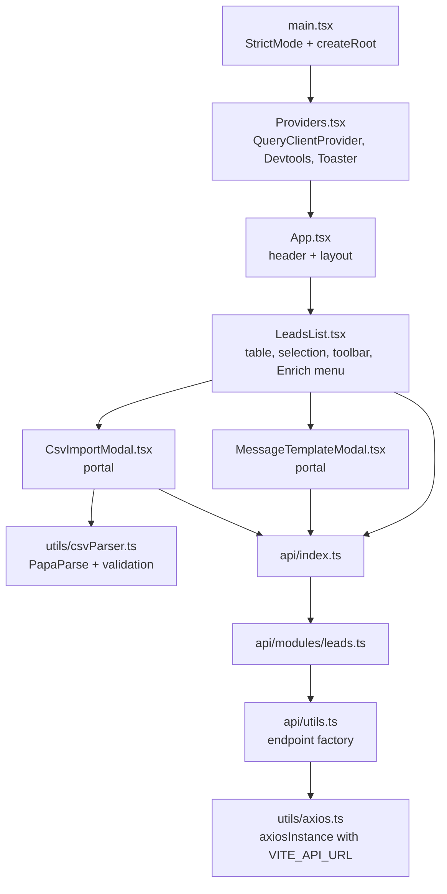
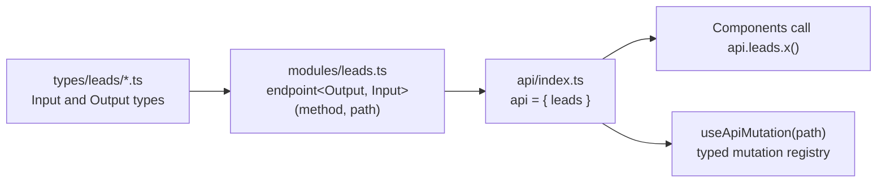

# 03 - Frontend

## Structure

The frontend is a React 18 single page application in ESM TypeScript, built with Vite and the SWC React plugin.
There is no router, because the product is one page.

## Components

| Component | Lines | Responsibilities |
| --- | --- | --- |
| `LeadsList` | 334 | Fetches leads, renders the table, manages selection, toolbar, Enrich dropdown, delete and verify mutations, loading, error, and empty states. |
| `CsvImportModal` | 354 | File picking and drag-and-drop, parsing, preview table, summary stats, import mutation, escape and backdrop handling, body scroll lock. |
| `MessageTemplateModal` | 304 | Template editor, field insertion at the caret, generate mutation, per-lead error display, escape and backdrop handling, body scroll lock. |

- Each component owns its data fetching, mutations, local UI state, and markup, with no container and presentational split.
- Markup is inline Tailwind classes and inline SVG icons, even though `@tabler/icons-react` is a dependency.
- Both modals duplicate the same portal, backdrop, escape key, and scroll lock logic.
- Table columns are hardcoded in JSX, so each new lead field requires editing header and row markup.
- The Enrich dropdown has no click-outside handler and no keyboard navigation.
- "Guess Gender" is a placeholder that shows an error toast.
- Email verification state is shown as emoji next to the email, without a pending state during verification.
- The error state offers a full page reload instead of a query refetch.

## API client layer

The API layer is a small typed RPC-style wrapper over axios.

- `endpoint()` is an overloaded factory that returns a function taking the input, and sends it as query params for `GET` or as the body otherwise.
- Path builders such as `({ id }) => /leads/${id}` send the whole input, including `id`, in the body.
- Request and response types are hand-written per endpoint and are not generated from the backend.
- `useApiMutation` resolves a dotted path such as `leads.create` to preconfigured mutation options with optimistic updates.
- `useApiMutation` relies on `lodash.get`, `ts-toolbelt`, and recursive conditional types, but no component uses it.
- `MAX_UPLOAD_FILE_SIZE` is exported but never used.

### Contract drift with the backend

| Endpoint | Frontend contract | Backend behavior |
| --- | --- | --- |
| `leads.create` | Sends `firstName` | Reads `name`, so the request returns 400. |
| `leads.update` | Uses `PUT /leads/:id` with `firstName` | Exposes `PATCH /leads/:id` reading `name`, so the request returns 404. |
| `leads.getMany` | `lastName` and `email` nullable | Both are required in the schema. |
| `leads.getOne` | Returns `{ id, firstName, email }` | Returns the full lead or `null`. |
| `leads.create` output | `{ id, firstName, email }` | Returns the full lead. |

The optimistic lead built in `useApiMutation` lacked `emailVerified`, which caused a TS2741 error that broke `pnpm build`.
The fix-csv-country-codes change added the field, and [an improvement note](../improvements/remove-unused-api-mutation-registry.md) proposes removing the unused hook.

## State management

- Server state lives in TanStack Query under the single key `['leads', 'getMany']`.
- Every mutation invalidates that key on success, so the whole table is refetched after each action.
- The leads query disables retries.
- UI state such as selection and modal visibility is local `useState` in `LeadsList`.
- Selected lead IDs are not pruned after a refetch, so a deleted lead can remain selected.
- `QueryClient` uses library defaults, and React Query Devtools are rendered unconditionally.

## CSV parsing

`parseCsv` in `frontend/src/utils/csvParser.ts` runs fully in the browser.

1. PapaParse reads the text with headers, trims values, and lowercases headers.
2. Critical parse errors of type `Delimiter`, `Quotes`, or `FieldMismatch` abort the import.
3. Each row maps normalized headers to fields with a `switch`, and unknown columns are ignored.
4. Required fields and email format are validated, and each row gets `isValid`, `errors`, and `rowIndex`.

- `countryCode` is kept as the raw string, because the backend owns conversion.
  The modal sends the file's distinct country values to `POST /leads/country-codes/normalize` and shows each row's result in a Country column through `CountryPreviewCell`.
  A converted value shows its code and "Converted from" the original, a cleared value shows a blank and "not recognized, left blank", and a failed check shows the raw value with a warning without blocking the import.
- `yearsInRole` and `phoneNumber` columns from the sample CSVs are silently dropped.
- The file is read with `FileReader.readAsText`, which assumes UTF-8.
- The extension check `file.name.endsWith('.csv')` is case-sensitive, so `.CSV` is rejected.
- The modal computes "duplicates in CSV" for display, but still sends those duplicates to the backend.

## Styling and assets

- Tailwind CSS 4 is loaded through `@tailwindcss/vite` and `@import 'tailwindcss'`.
- `tailwind.config.js` uses the v3 format and is not read by Tailwind 4 without an `@config` directive.
- `index.html` loads its favicon from an external CDN, while the header logo uses the local `favicon.svg`.
- The header logo link opens a new tab without `rel="noopener noreferrer"`.

## Tooling

- `tsconfig.app.json` enables `strict`, `noUnusedLocals`, and `noUnusedParameters`.
- `globalTypes.d.ts` declares `$TSFixMe` aliases for `any`, which weakens the strict settings where used.
- Prettier uses no semicolons, single quotes, and a 110 character print width.
- ESLint 9 runs from a flat `eslint.config.js` built on `typescript-eslint`, and `pnpm lint` passes.
- Vitest runs in jsdom with Testing Library, and `csvParser` and `CsvImportModal` have tests.
- `LeadsList.tsx` and `api/types/leads/verifyEmails.ts` are not formatted with the project's Prettier config.
