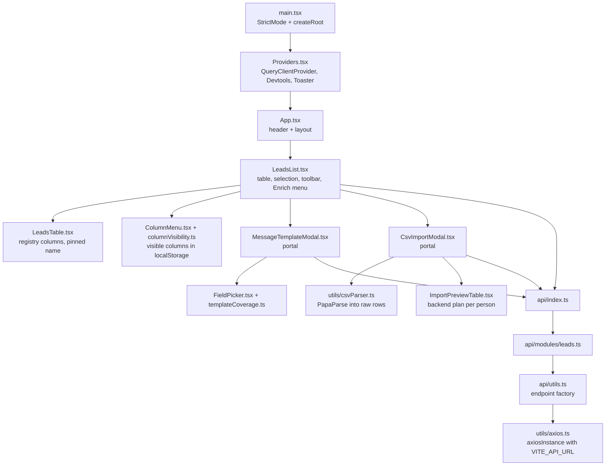
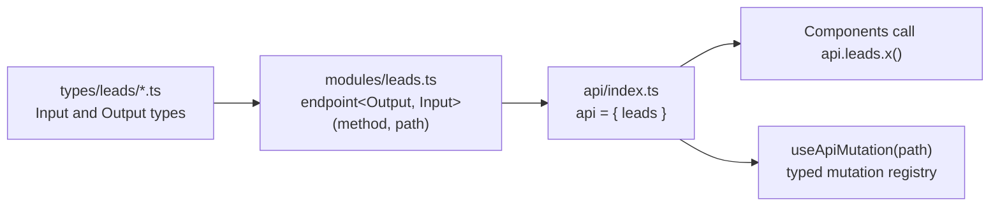

# 03 - Frontend

## Structure

The frontend is a React 18 single page application in ESM TypeScript, built with Vite and the SWC React plugin.
There is no router, because the product is one page.

## Components

| Component | Lines | Responsibilities |
| --- | --- | --- |
| `LeadsList` | 414 | Fetches leads and the field registry, manages selection, toolbar, Enrich dropdown, delete, verify, and phone lookup mutations, loading, error, and empty states. |
| `LeadsTable` | 149 | Renders the visible registry columns per field type, with pinned selection and name columns, `tel:` and LinkedIn links, truncation, and `customCells` overrides per field. |
| `PhoneCell` | 103 | Shows a lead's phone with its source, the provider being tried, "No data found" or "Lookup failed" with Retry, and a confirmed Re-enrich. |
| `CsvImportModal` | 304 | File picking and drag-and-drop, parsing into raw rows, the backend preview, summary stats, and the import mutation. |
| `ImportPreviewTable` | 112 | Shows the backend's import plan per person, with roles, years at company, and notes, plus invalid rows. |
| `MessageTemplateModal` | 319 | Template editor, field insertion at the caret, missing-field warnings, generate mutation, and per-lead error display. |
| `FieldPicker` | 75 | Grouped, searchable list of templatable registry fields. |

- Each component owns its data fetching, mutations, local UI state, and markup, with no container and presentational split.
- Markup is inline Tailwind classes and inline SVG icons, even though `@tabler/icons-react` is a dependency.
- Both modals duplicate the same portal, backdrop, escape key, and scroll lock logic.
- Table columns, the column menu, and the composer's fields come from `GET /leads/fields` ([decision 0003](../decisions/0003-lead-field-registry.md)), so a new field needs no markup change unless it has a new type.
- The Enrich dropdown has no click-outside handler and no keyboard navigation.
- "Guess Gender" is a placeholder that shows an error toast.
- `EmailVerificationCell` shows each lead's verification status under the email: a spinner while verifying, labelled icons for the outcomes, and a Retry button when a check could not complete.
- `PhoneCell` replaces the phone column through `customCells`, and its hover title lists what each provider returned.
- The error state offers a full page reload instead of a query refetch.

## API client layer

The API layer is a small typed RPC-style wrapper over axios.

- `endpoint()` is an overloaded factory that returns a function taking the input, and sends it as query params for `GET` or as the body otherwise.
- Path builders such as `({ id }) => /leads/${id}` send the whole input, including `id`, in the body.
- Request and response types are hand-written per endpoint and are not generated from the backend.
- `useApiMutation` resolves a dotted path such as `leads.create` to preconfigured mutation options with optimistic updates.
- `useApiMutation` relies on `lodash.get`, `ts-toolbelt`, and recursive conditional types, but no component uses it.
- `MAX_UPLOAD_FILE_SIZE` is exported but never used.

### Contract drift with the backend

| Endpoint | Frontend contract | Backend behavior |
| --- | --- | --- |
| `leads.create` | Sends `firstName` | Reads `name`, so the request returns 400. |
| `leads.update` | Uses `PUT /leads/:id` with `firstName` | Exposes `PATCH /leads/:id` reading `name`, so the request returns 404. |
| `leads.getMany` | `lastName` and `email` nullable | Both are required in the schema. |
| `leads.getOne` | Returns `{ id, firstName, email }` | Returns the full lead or `null`. |
| `leads.create` output | `{ id, firstName, email }` | Returns the full lead. |

The optimistic lead built in `useApiMutation` lacked `emailVerified`, which caused a TS2741 error that broke `pnpm build`.
The fix-csv-country-codes change added the field, and [an improvement note](../improvements/remove-unused-api-mutation-registry.md) proposes removing the unused hook.

## State management

- Server state lives in TanStack Query under `['leads', 'getMany']`, `['leads', 'fields']` (fetched once), and `['leads', 'importPreview', ...]` per loaded file.
- Every mutation invalidates the leads key on success, so the whole table is refetched after each action.
- The leads query disables retries, and refetches every two seconds while any lead's email verification or phone lookup is `PENDING` (`leadsPolling.ts`).
- UI state such as selection and modal visibility is local `useState` in `LeadsList`, and the visible table columns persist in `localStorage` under a versioned key.
- Selected lead IDs are not pruned after a refetch, so a deleted lead can remain selected.
- `QueryClient` uses library defaults, and React Query Devtools are rendered unconditionally.

## CSV parsing

`readCsvRows` in `frontend/src/utils/csvParser.ts` only turns the file text into rows, keeping headers as written.
Header mapping, grouping into people, and validation happen in the backend ([decision 0004](../decisions/0004-backend-computes-the-import-plan.md)).

1. PapaParse reads the text with headers, trims headers and values, and skips empty lines.
2. Critical parse errors of type `Delimiter`, `Quotes`, or `FieldMismatch`, and files without data rows, abort with a message.
3. The modal sends the raw rows to `POST /leads/import/preview` and renders the returned plan with `ImportPreviewTable`.
4. Importing sends the same raw rows to `POST /leads/bulk`; if the preview fails, the import stays disabled.

- The file is read with `FileReader.readAsText`, which assumes UTF-8.
- The extension check `file.name.endsWith('.csv')` is case-sensitive, so `.CSV` is rejected.

## Styling and assets

- Tailwind CSS 4 is loaded through `@tailwindcss/vite` and `@import 'tailwindcss'`.
- `tailwind.config.js` uses the v3 format and is not read by Tailwind 4 without an `@config` directive.
- `index.html` loads its favicon from an external CDN, while the header logo uses the local `favicon.svg`.
- The header logo link opens a new tab without `rel="noopener noreferrer"`.

## Tooling

- `tsconfig.app.json` enables `strict`, `noUnusedLocals`, and `noUnusedParameters`.
- `globalTypes.d.ts` declares `$TSFixMe` aliases for `any`, which weakens the strict settings where used.
- Prettier uses no semicolons, single quotes, and a 110 character print width.
- ESLint 9 runs from a flat `eslint.config.js` built on `typescript-eslint`, and `pnpm lint` passes.
- Vitest runs in jsdom with Testing Library, and the parser, the import modal, the leads list and table columns, and the message composer have tests built on shared fixtures in `src/test/fixtures.ts`.
- The shared test setup stubs `matchMedia`, which jsdom lacks, and provides an in-memory `localStorage` when Node 25+ hides jsdom's.
