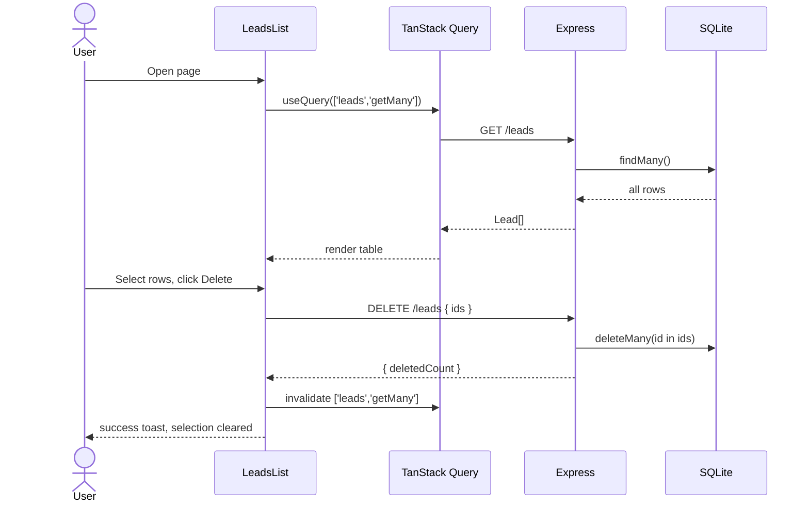
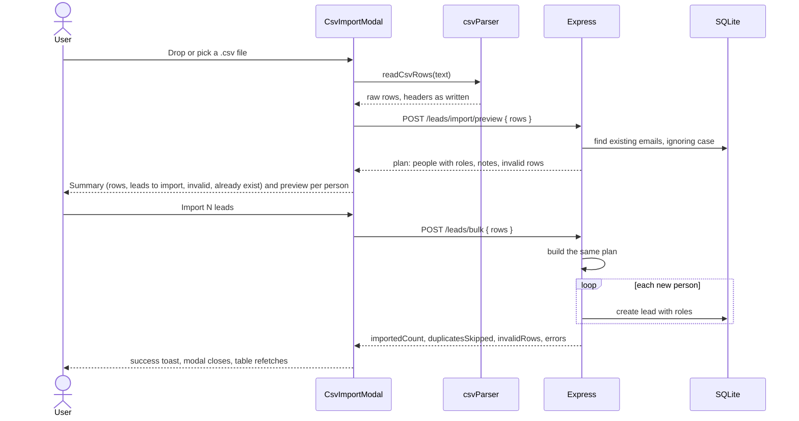
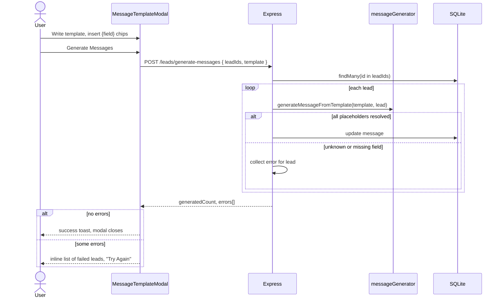
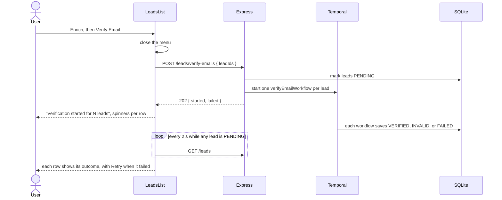

# 04 - Features

This document lists every user-facing feature and traces it end to end.
The wireframes in `docs/ui-wireframes.png` show the intended UX for the table, the Enrich menu, message generation, and CSV import.

## Feature inventory

| Feature | UI entry point | Backend | Status |
| --- | --- | --- | --- |
| List leads | Page load | `GET /leads`, `GET /leads/fields` | Working, unpaginated, with configurable columns including phone, LinkedIn, and years. |
| Select leads | Row and header checkboxes | - | Working, with indeterminate header state. |
| Delete leads | Toolbar "Delete" | `DELETE /leads` | Working, no confirmation dialog. |
| Import leads from CSV | Toolbar "Import CSV" | `POST /leads/import/preview`, `POST /leads/bulk` | Working, with people grouped by email into role histories and invalid values blanked with notes. |
| Generate messages | Enrich, then "Generate Messages" | `POST /leads/generate-messages` | Working, with every templatable field and missing-field warnings. |
| Verify emails | Enrich, then "Verify Email" | `POST /leads/verify-emails` and Temporal | Working in the background, with per-row progress and outcomes. |
| Guess gender | Enrich, then "Guess Gender" | none | Placeholder toast only. |
| Create, read, update, delete one lead | No UI | `POST`, `GET`, `PATCH`, `DELETE /leads/:id` | API only, create and update contracts are broken. |

## List, select, and delete

## CSV import

- One function builds the plan for both the preview and the import, so the preview shows exactly what will be stored ([decision 0004](../decisions/0004-backend-computes-the-import-plan.md)).
- Rows with the same email become one person with a role history; years at company sum the roles at the current company.
- The current role is the last row, unless an `isCurrentRole` column marks another.
- Invalid phone, LinkedIn, years, or country values are stored blank with a note, and countries are converted to ISO codes, so `12` becomes `DZ` and `XXX` is blank.
- Existing leads are matched by email, ignoring case, and identical rows for one person are merged with a note.
- Per-person backend errors during the write are returned but not shown to the user.

## Message generation

- Fields come from the registry in a grouped, searchable picker, so the list scales as fields grow.
- Before generating, the composer shows how many selected leads lack each used field and flags unknown fields.
- A lead missing a used field gets no message and is listed afterwards, a product decision that differs from the wireframe's empty message.
- There is no preview of the rendered message before saving.

## Email verification

- The request returns at once, and each lead's outcome appears on its own as soon as its workflow ends.
- A check that never answers ends as "Couldn't verify" in about 18 seconds, and the user can retry it from the row.
- Starting again while a lead is pending joins the running verification instead of starting a second one.
- This was the fix for the README's "Email verification stalls" bug, see [FIX-002](../fixes/FIX-002-email-verification-stall.md).

## Features requested by the README

This table shows where each README feature fits and whether it is done.

| Feature | Touch points in the current design |
| --- | --- |
| New fields: phone number, years at company, LinkedIn URL | Done by the add-lead-fields change, see [the feature document](../features/add-lead-fields.md). |
| Enrich phone with three providers in sequence | New Temporal workflow and provider activities, a provider abstraction, a workflow ID per lead for idempotency, an asynchronous start endpoint, a status representation on the lead, and progress feedback in the table. |
| Email verification feedback | Done by the fix-email-verification-stall change, see [FIX-002](../fixes/FIX-002-email-verification-stall.md). |
| Country code validation | Done by the fix-csv-country-codes change, see [FIX-001](../fixes/FIX-001-csv-country-codes.md). |
