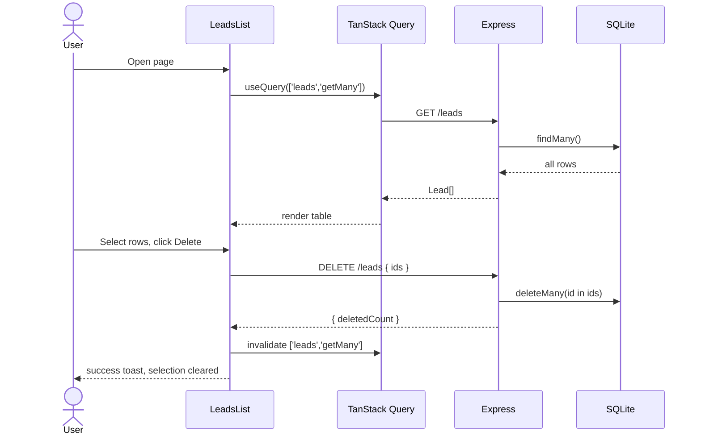
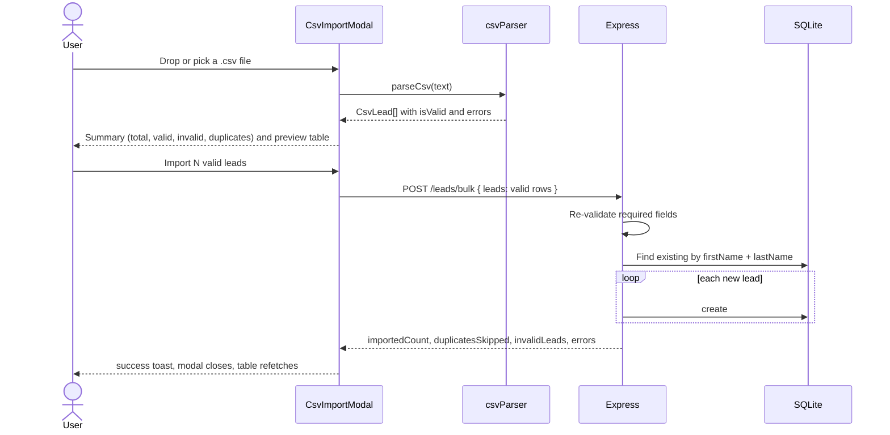
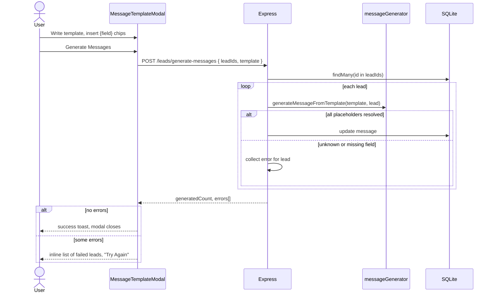
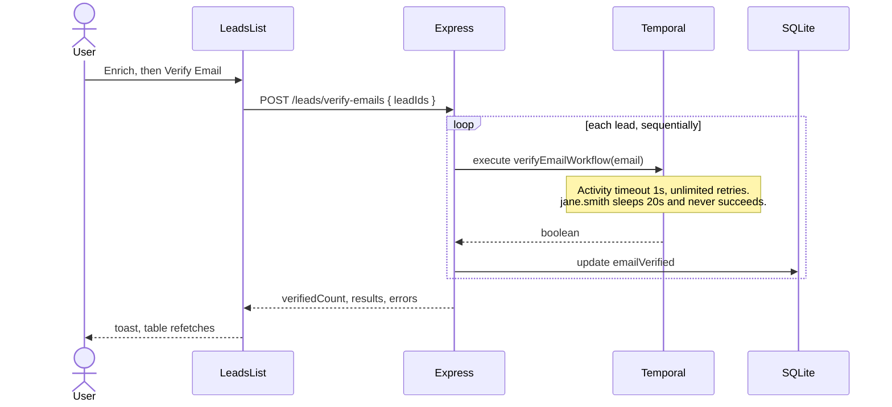

# 04 - Features

This document lists every user-facing feature and traces it end to end.
The wireframes in `docs/ui-wireframes.png` show the intended UX for the table, the Enrich menu, message generation, and CSV import.

## Feature inventory

| Feature | UI entry point | Backend | Status |
| --- | --- | --- | --- |
| List leads | Page load | `GET /leads` | Working, unpaginated. |
| Select leads | Row and header checkboxes | - | Working, with indeterminate header state. |
| Delete leads | Toolbar "Delete" | `DELETE /leads` | Working, no confirmation dialog. |
| Import leads from CSV | Toolbar "Import CSV" | `POST /leads/bulk` | Working, with the country code defect. |
| Generate messages | Enrich, then "Generate Messages" | `POST /leads/generate-messages` | Working. |
| Verify emails | Enrich, then "Verify Email" | `POST /leads/verify-emails` and Temporal | Hangs for some leads. |
| Guess gender | Enrich, then "Guess Gender" | none | Placeholder toast only. |
| Create, read, update, delete one lead | No UI | `POST`, `GET`, `PATCH`, `DELETE /leads/:id` | API only, create and update contracts are broken. |

## List, select, and delete

## CSV import

- Validation runs twice, in the browser for preview and in the backend for safety, with different rules.
- The browser validates email format, while the backend only checks that email is a non-empty string.
- Neither side validates `countryCode`, which is the cause of the "CSV country codes" bug in the README.
- The sample `docs/leads-with-errors.csv` contains country values `XXX` and `12`, and they are imported and displayed as is.
- Per-row backend errors are returned but not shown to the user.

## Message generation

- Insertable fields are a hardcoded list of six chips, which will not scale as fields grow.
- The wireframe expects missing fields to produce an empty message with a warning, while the code skips the lead and reports an error.
- There is no preview of the rendered message before saving.

## Email verification

- The HTTP request stays open until every workflow finishes.
- When any selected lead hits the slow path, the request never returns and the UI shows no progress.
- The menu stays open during the request and the button has no pending state.

## Features requested by the README

These features are not implemented yet and are listed here to show where they fit.

| Feature | Touch points in the current design |
| --- | --- |
| New fields: phone number, years at company, LinkedIn URL | Prisma model and migration, bulk import mapping, `messageGenerator` allow-list and `Lead` type, frontend types, `csvParser` switch, `CsvImportModal` mapping and help text, `MessageTemplateModal` field list, `LeadsList` columns. |
| Enrich phone with three providers in sequence | New Temporal workflow and provider activities, a provider abstraction, a workflow ID per lead for idempotency, an asynchronous start endpoint, a status representation on the lead, and progress feedback in the table. |
| Email verification feedback | Activity timeout and retry policy, asynchronous start with status polling or streaming, per-lead pending state in the UI. |
| Country code validation | Shared validation rule for ISO 3166-1 alpha-2 in the CSV parser and the bulk endpoint. |
