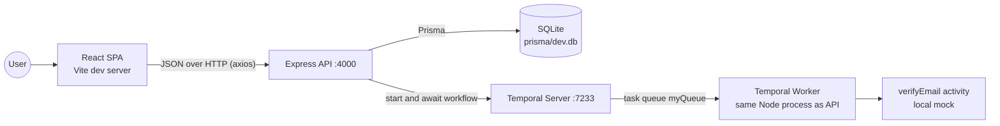

# TinyEnginy - Architecture and Code Design

This folder describes the architecture, code design, and features of the TinyEnginy take-home codebase as found at commit `67c2047`.
It is the reference baseline for the OpenSpec specifications, bug fix specs, decisions, and improvements that follow.

## Documents

| Document | Content |
| --- | --- |
| [01-system-overview.md](./01-system-overview.md) | System context, runtime topology, technology stack, configuration, and quality gates. |
| [02-backend.md](./02-backend.md) | Express API, data model, Prisma persistence, and the Temporal worker. |
| [03-frontend.md](./03-frontend.md) | React application, component tree, API client layer, and state management. |
| [04-features.md](./04-features.md) | End-to-end flows for every user-facing feature, with sequence diagrams. |
| [05-assessment.md](./05-assessment.md) | Code design assessment: strengths, defects, risks, and how they relate to the README tasks. |

## Summary

TinyEnginy is a small lead management tool.
A user imports leads from CSV, sees them in a table, generates templated outreach messages, and verifies emails.
The system is two independent Node.js packages in one repository, with no shared code.

- **Backend** is a single-file Express 5 API on port 4000 backed by SQLite through Prisma.
- **Backend** also embeds a Temporal worker in the same process to run the email verification workflow.
- **Frontend** is a React 18 single page application built with Vite, styled with Tailwind CSS 4, and using TanStack Query for server state.

## Key takeaways

- The codebase is intentionally small and contains seeded defects that match the README tasks.
- The main design weaknesses are a monolithic route file with no validation layer, lead field lists duplicated across both packages, and an HTTP request that blocks on long-running workflows.
- The Temporal integration is the natural extension point for the phone enrichment feature, but it needs an asynchronous start-and-observe model first.
- At analysis time, unit tests pass in both packages, the frontend build fails on a type error, and the frontend lint command fails on configuration.
