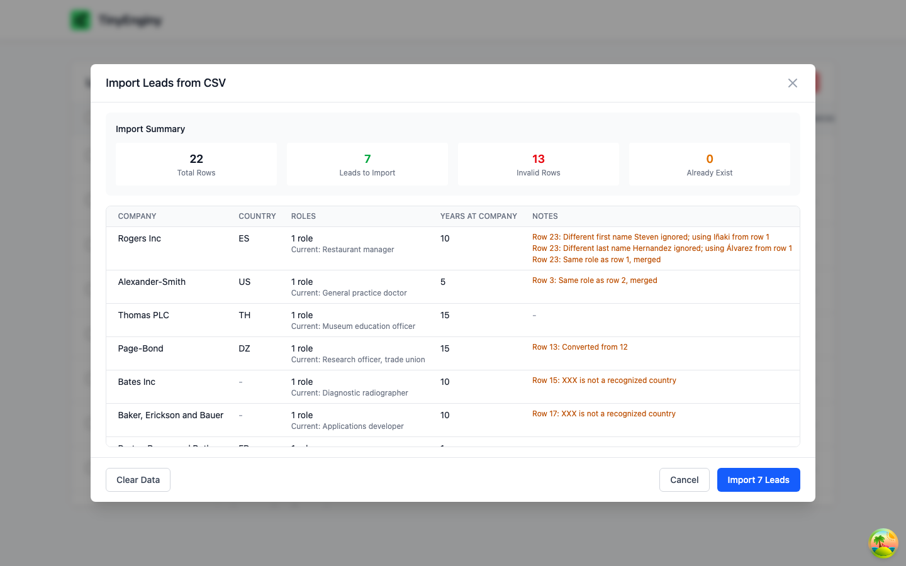
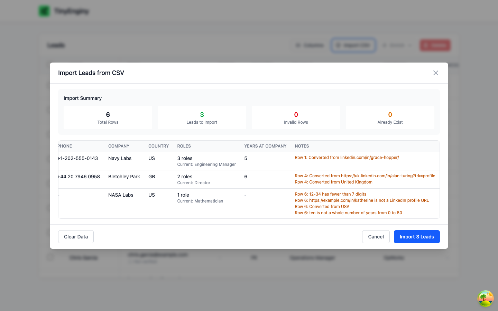
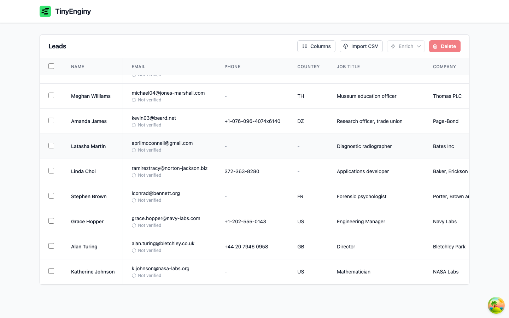
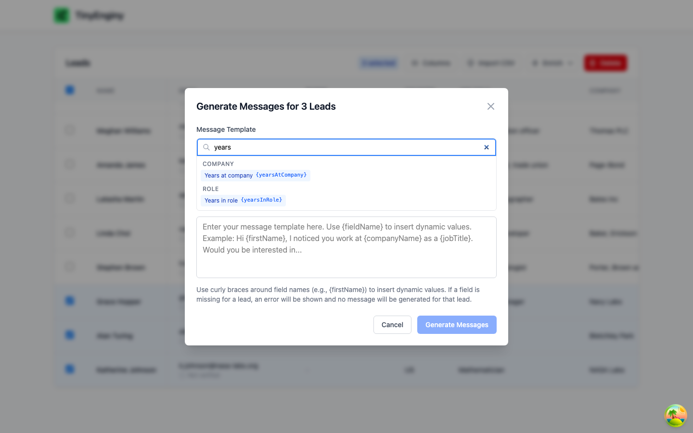
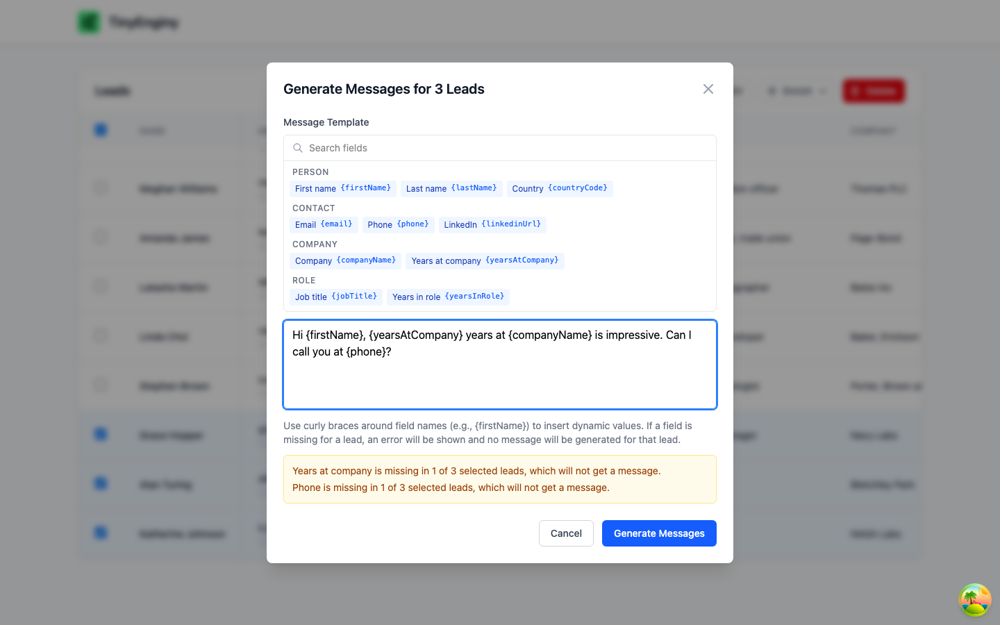
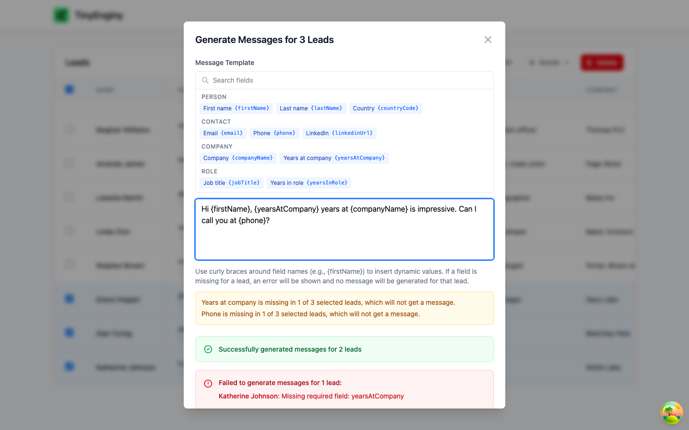

# Feature - New lead fields

| Field | Value |
| --- | --- |
| OpenSpec change | [add-lead-fields](../../openspec/changes/archive/2026-10-30-add-lead-fields/proposal.md) |
| Capabilities | `lead-profile`, `lead-import`, `message-composition`, `leads-table` |
| Assessment findings | A2, A3, and D7 in [05-assessment.md](../architecture/05-assessment.md) |
| Depends on | `fix-email-verification-stall` |
| Status | Implemented |

## Problem

Users need a lead's phone number, LinkedIn profile, and years at the current company in the table, from CSV import, and in messages.
The field list is duplicated in about 11 places, and the message composer does not scale as fields grow.

## Product decisions

Decided with the product owner on 2026-10-30 during exploration.

- Years at company is the sum of years in each role held at that company, so leads keep a role history.
- The current role is the last row for a person in file order, unless an optional `isCurrentRole` column marks another row.
- A lead missing a field used in a message template gets no message, with a warning before generating and the lead listed afterwards.

## Proposed defaults

These follow the exploration and are open to review in the change's design.

- Rows group into one person by email, and duplicate detection moves from name to email.
- Phone is stored as cleaned text, LinkedIn as one canonical profile URL, and invalid values are blanked with a preview note.
- One backend field registry drives the import, templates, and table columns.
- The composer uses a grouped, searchable field picker, and the table gets a column visibility menu.

## Evidence

### Baseline (task 1.2)

Imported `docs/leads-ok-1.csv` through the UI with Playwright on 2026-10-30, before any change.

- The file's header includes `yearsInRole` and `phoneNumber`, for example `Chad,Smith,...,2,+1-280-754-0462x2154`.
- The preview shows no phone or years, and all 5 rows import.
- The stored lead has only `firstName`, `lastName`, `email`, `jobTitle`, `countryCode`, `companyName`, `message`, `emailVerificationStatus`, and timestamps, so both values are dropped.

### Import of every sample file (task 8.1)

Imported each file in `docs/` through the UI with Playwright on 2026-10-30, starting from the migrated seed database.
`docs/leads-roles.csv` was added because no other sample has one person with several roles.

| File | Rows | Leads imported | Invalid rows | Already existed |
| --- | --- | --- | --- | --- |
| `leads-ok-1.csv` | 5 | 5 | 0 | 0 |
| `leads-ok-2.csv` | 5 | 5 | 0 | 0 |
| `leads-ok-3.csv` | 5 | 5 | 0 | 0 |
| `leads-ok-missing fields.csv` | 8 | 0 | 3 | 5 (already in the seed data, now matched by email) |
| `leads-with-errors.csv` | 22 | 7 | 13 | 0 |
| `leads-roles.csv` | 6 | 3 | 0 | 0 |

- `leads-with-errors.csv` now imports 7 people instead of 9, because Curtis Monson's two identical rows merge into one role, and Steven Hernandez shares Iñaki Álvarez's email, so both rows are one person with notes about the differing name.
- Grace Hopper has three roles, her current role is Engineering Manager, and her years at Navy Labs are 5, leaving out 4 years at Globex.
- Alan Turing's current role is Director because `isCurrentRole` marks it, although it is first in the file, and his years at Bletchley Park are 6.
- Katherine Johnson is imported with phone, LinkedIn, and years blank, and the preview explains each value.

### Message composition (task 8.2)

Selected Grace Hopper, Alan Turing, and Katherine Johnson and used the template `Hi {firstName}, {yearsAtCompany} years at {companyName} is impressive. Can I call you at {phone}?`.

- Before generating, the composer warned that years at company and phone are each missing in 1 of 3 selected leads.
- Grace and Alan got "Hi Grace, 5 years at Navy Labs is impressive. Can I call you at +1-202-555-0143?" and "Hi Alan, 6 years at Bletchley Park is impressive. Can I call you at +44 20 7946 0958?".
- Katherine got no message and was listed with the missing field.

### Fixes found during verification

- Preview cells wrapped mid-word, so preview rows now stay on one line and the table scrolls horizontally.
- The field picker hid its last group, so it is taller and still scrolls as fields grow.
- The pinned name column had no visible edge and hover only colored it, so it has a divider shadow and hover colors the whole row.
