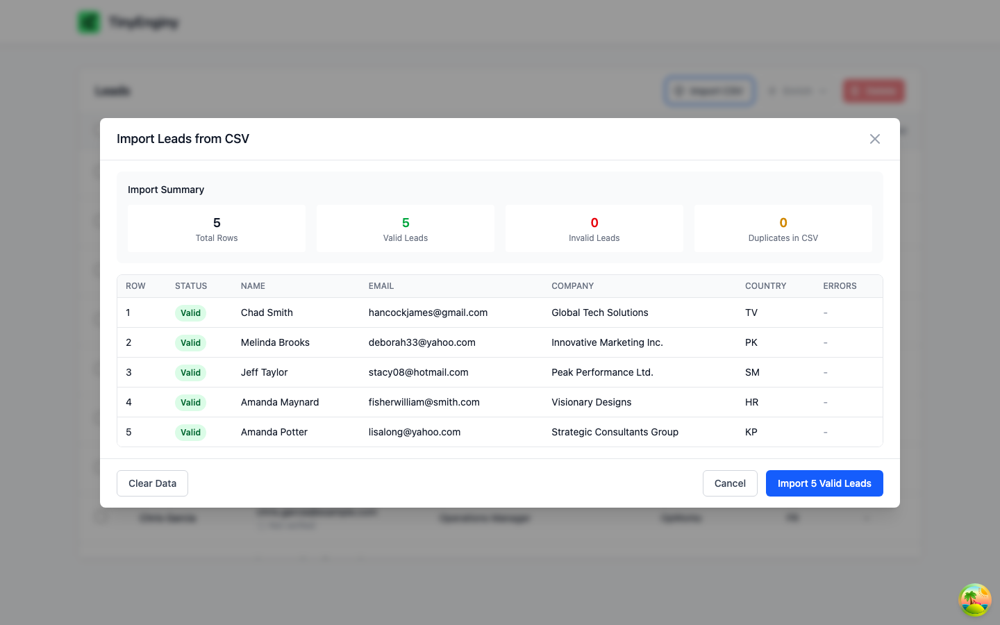
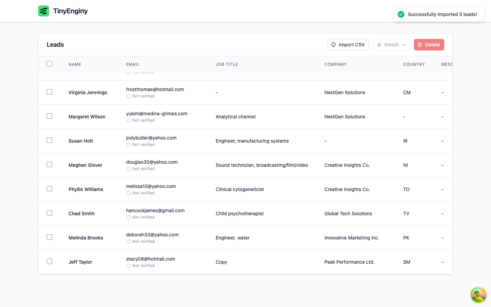

# Feature - New lead fields

| Field | Value |
| --- | --- |
| OpenSpec change | [add-lead-fields](../../openspec/changes/add-lead-fields/proposal.md) |
| Capabilities | `lead-profile`, `lead-import`, `message-composition`, `leads-table` |
| Assessment findings | A2, A3, and D7 in [05-assessment.md](../architecture/05-assessment.md) |
| Depends on | `fix-email-verification-stall` |
| Status | Planned |

## Problem

Users need a lead's phone number, LinkedIn profile, and years at the current company in the table, from CSV import, and in messages.
The field list is duplicated in about 11 places, and the message composer does not scale as fields grow.

## Product decisions

Decided with the product owner on 2026-10-30 during exploration.

- Years at company is the sum of years in each role held at that company, so leads keep a role history.
- The current role is the last row for a person in file order, unless an optional `isCurrentRole` column marks another row.
- A lead missing a field used in a message template gets no message, with a warning before generating and the lead listed afterwards.

## Proposed defaults

These follow the exploration and are open to review in the change's design.

- Rows group into one person by email, and duplicate detection moves from name to email.
- Phone is stored as cleaned text, LinkedIn as one canonical profile URL, and invalid values are blanked with a preview note.
- One backend field registry drives the import, templates, and table columns.
- The composer uses a grouped, searchable field picker, and the table gets a column visibility menu.

## Evidence

### Baseline (task 1.2)

Imported `docs/leads-ok-1.csv` through the UI with Playwright on 2026-10-30, before any change.

- The file's header includes `yearsInRole` and `phoneNumber`, for example `Chad,Smith,...,2,+1-280-754-0462x2154`.
- The preview shows no phone or years, and all 5 rows import.
- The stored lead has only `firstName`, `lastName`, `email`, `jobTitle`, `countryCode`, `companyName`, `message`, `emailVerificationStatus`, and timestamps, so both values are dropped.

