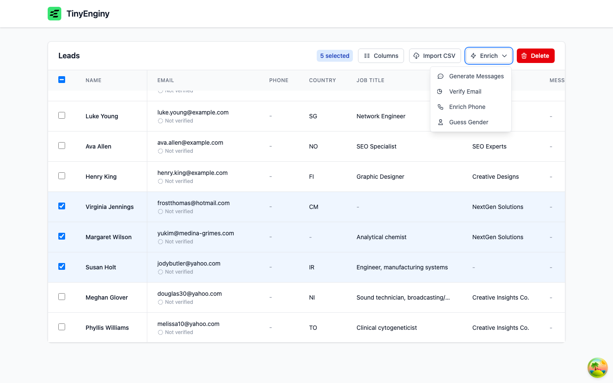
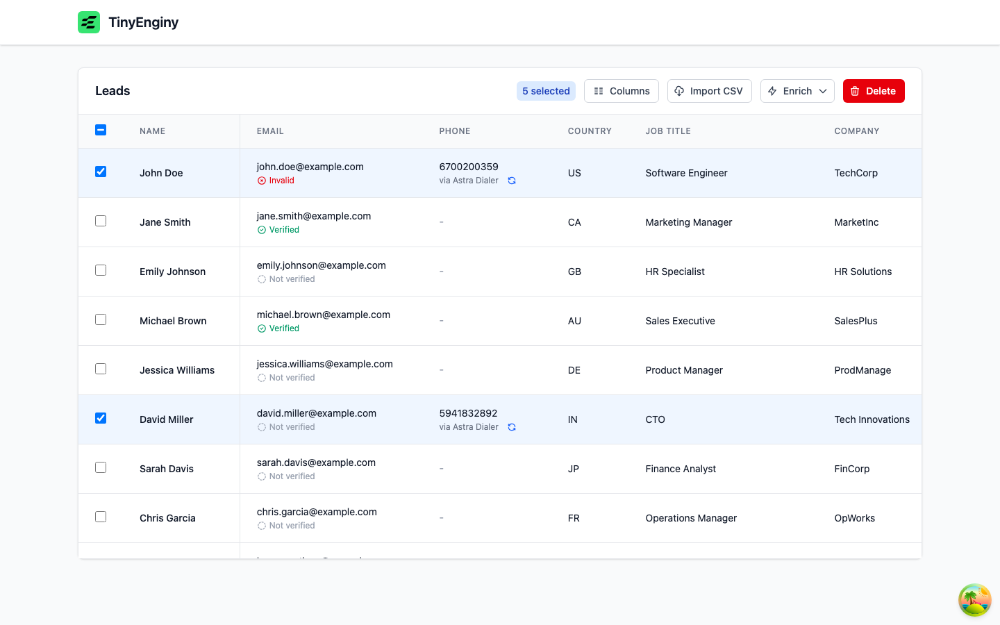
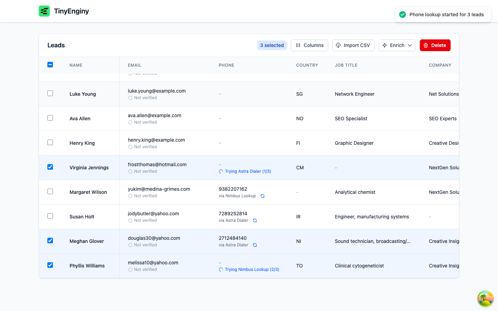
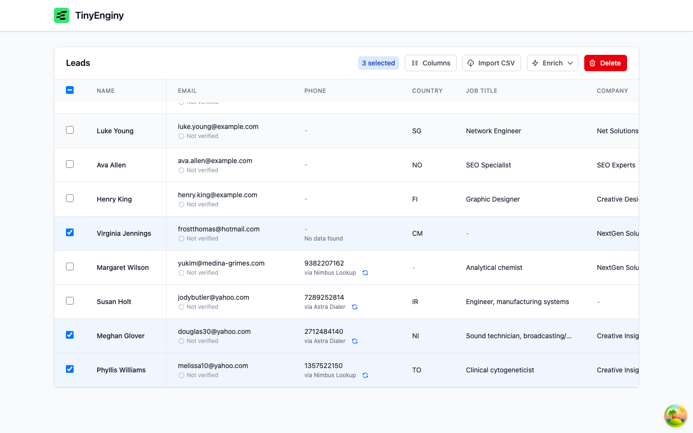
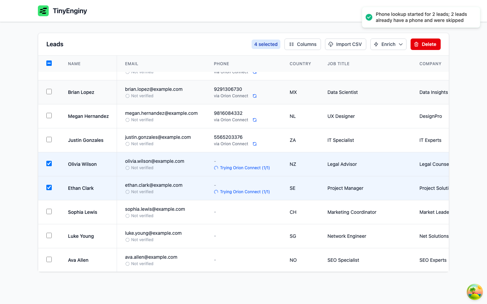
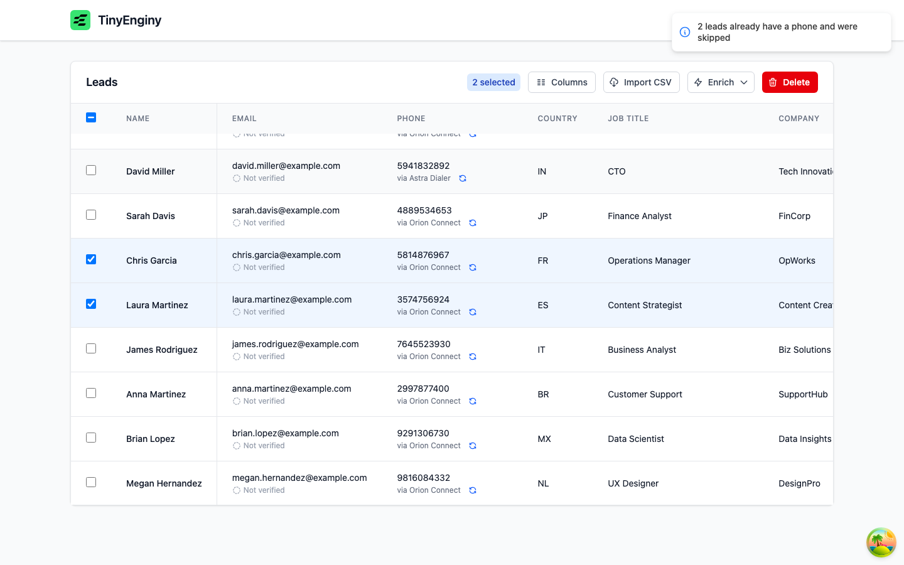

# Feature - Enrich phone

| Field | Value |
| --- | --- |
| OpenSpec change | [enrich-lead-phone](../../openspec/changes/enrich-lead-phone/proposal.md) |
| Capability | `phone-enrichment` |
| Depends on | `fix-email-verification-stall`, `add-lead-fields` |
| Status | Planned |

## Problem

Many leads have no phone, and three external providers can find one.
Lookups must try providers in sequence, stop early, stay bounded in time, run once per lead, show progress, and be ready for provider rate limits.

## Product decisions

Decided with the product owner on 2026-10-30 during exploration.

- Providers run fastest first for now: Astra Dialer, then Nimbus Lookup, then Orion Connect, with the order kept in configuration.
- Orion Connect's company website is the domain of the lead's business email, and free email addresses skip Orion.
- Leads that already have a phone are skipped, and an explicit "Re-enrich phone" action replaces the number.
- A lookup where a provider errored after its retries and none found a phone ends as "Failed", with a retry offered.

## Findings from live provider probes

Recorded on 2026-10-30 with synthetic inputs only.

- Nimbus Lookup returns `phoneNmbr` and `countryCode`, not the `number` field the README documents.
- Orion Connect takes about 4.2 seconds, and every provider returned HTTP 500 on some calls.
- No provider sends rate-limit headers yet.

## Evidence

### Provider probes (task 1.2)

Re-probed on 2026-10-30 with synthetic inputs (`john.doe@example.com`, `CTO`, `Ada Lovelace`, `example.com`), three calls each plus one missing-field and one wrong-key call.

| Provider | Status | Latency | Body |
| --- | --- | --- | --- |
| Astra Dialer | 200, 200, 200 | 0.2 s, 1.3 s, 0.2 s | `{"phoneNmbr":null}`, `{"phoneNmbr":"3857448574"}`, `{"phoneNmbr":null}` |
| Nimbus Lookup | 200, 200, 200 | 2.2 s to 2.4 s | `{"phoneNmbr":9995992355,"countryCode":"ES"}` and similar |
| Orion Connect | 500, 200, 500 | 1.5 s, 5.7 s, 0.2 s | `{"message":"Internal server error"}` or `{"phone":"6480136887"}` |

- Every provider answers 400 `{"message":"Missing required input"}` for a missing field and 401 `Unauthorized` for a wrong key.
- No provider sends rate-limit or `Retry-After` headers yet.
- Compared with the design: Astra also signals "no phone" as `{"phoneNmbr":null}`, which its normalizer already treats as not found, and Orion's slowest success (5.7 s) stays inside its 10-second attempt limit.

### End to end with the real providers (task 8.1)

Run on 2026-10-30 against the live provider endpoints, with the stack started as in the README and every action taken in the browser.

| Leads | Configuration | What the table showed |
| --- | --- | --- |
| Two `example.com` leads and two Yahoo leads | Default order | Each phone "via Astra Dialer" within 4 seconds. |
| `medina-grimes.com` lead | Default order | Astra had no phone, then the phone "via Nimbus Lookup". |
| Yahoo lead with a job title | Default order | "Trying Astra Dialer (1/3)", "Trying Nimbus Lookup (2/3)", then the phone "via Nimbus Lookup"; Orion was skipped for the free email domain. |
| Hotmail lead without a job title | Default order | "No data found", with "Astra Dialer: no phone", "Nimbus Lookup: skipped, no job title", and "Orion Connect: skipped, no business domain" on hover. |
| Two leads with a phone and two without | Orion only | One toast, "Phone lookup started for 2 leads; 2 leads already have a phone and were skipped", and "Trying Orion Connect (1/1)" on the two looked up. |
| Two leads with a phone | Orion only | An info toast, "2 leads already have a phone and were skipped", and no lookup. |

Numbers the providers return that are not valid for the lead's country, such as `6700200359` for a US lead, are stored as returned, while a valid one such as Orion's German number is stored as `+494049999211`.

Issues found and fixed during this run:

- Skip reasons read "skipped, Missing job title" mid-sentence, so the providers now give lowercase reasons.
- The phone column widened by about 40 pixels while a row showed a progress label, so the cell now has a fixed minimum width.
- The started and skipped toasts stacked over the Enrich and Delete buttons, so they are now one toast, and a skip-only result gets an info icon.

### Orion rate limit (task 8.2)

With `PHONE_PROVIDER_ORDER=ORION` and `PHONE_ORION_MAX_PER_SECOND=1`, five leads were enriched at once, and a local proxy in front of Orion logged when every request, retries included, arrived.
The Temporal history only keeps each activity's last attempt, so it cannot show every call.

| Setup | Calls | Smallest gap between calls |
| --- | --- | --- |
| Task queue limit only, as first designed | 7 | 0.000 s: three calls arrived within 15 ms, then two, then two |
| Plus the worker's own limit and one poll at a time | 7 | 0.787 s |
| Plus spacing calls in the worker, as built | 8 | 0.988 s, every other gap 1.000 s or more |

The server limit holds the average rate but releases short bursts, one per task queue partition and open poll, so the worker now also spaces its own calls ([decision 0006](../decisions/0006-one-task-queue-per-phone-provider.md)).
The one gap under a second is the first request arriving 12 ms late because it opened the connection; the worker sent the calls exactly one second apart.
