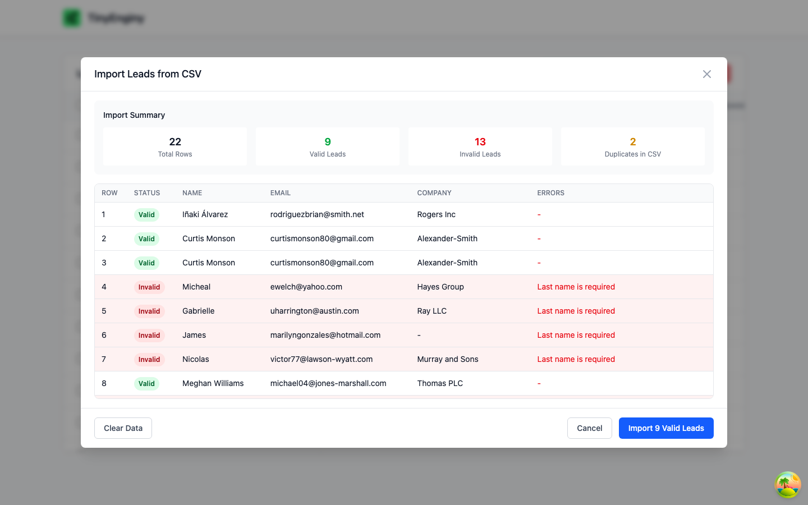
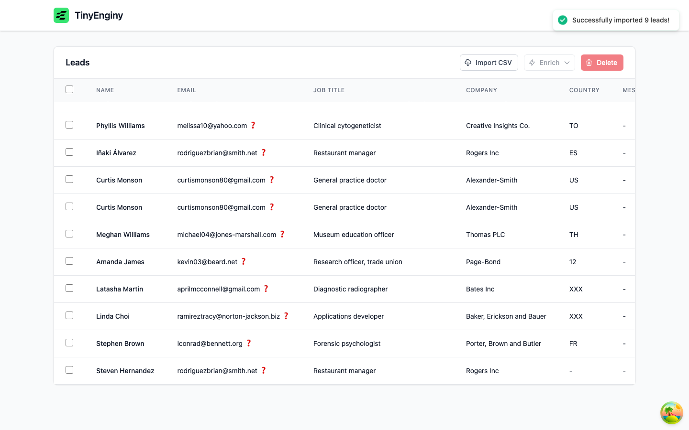

# FIX-001 - CSV import shows invalid country codes

| Field | Value |
| --- | --- |
| Fix ID | FIX-001 |
| OpenSpec change | [fix-csv-country-codes](../../openspec/changes/fix-csv-country-codes/proposal.md) |
| Capability | `lead-country-code` |
| Assessment finding | D2 in [05-assessment.md](../architecture/05-assessment.md) |
| Status | Planned |

## Symptom

After importing `docs/leads-with-errors.csv`, the Country column shows `XXX` and `12` instead of country codes.

## Reproduction

1. Start the backend, Temporal, and the frontend as described in the README.
2. Click "Import CSV" and select `docs/leads-with-errors.csv`.
3. Click "Import N Valid Leads".
4. Look at the Country column for the imported leads.

## Expected

Every country is a valid uppercase ISO 3166-1 alpha-2 code, or blank when the value cannot be converted.

## Actual

The values `XXX` (four rows) and `12` (one row) are stored and displayed as is.
The committed seed database also contains `UK`, which is not an ISO code.

## Root cause

No layer validates country values.
The browser parser accepts any non-empty string, and `POST /leads/bulk` stores it after trimming.
The CSV files are valid UTF-8, so the problem is invalid data, not character encoding.

## Fix summary

The backend converts every country value on import using codes, ISO numbers, aliases, and exact English names, and stores blank when the value is not recognized.
The import preview shows the converted value per row, and a backfill command cleans stored values.
See the change's design.md for details.

## Evidence

### Reproduction (task 1.1)

Reproduced on 2026-10-30 by importing `docs/leads-with-errors.csv` through the UI with Playwright against the local stack.
The preview has no Country column, so the user cannot see the bad values before importing.
After import, the table shows `12` for Amanda James and `XXX` for Latasha Martin and Linda Choi, and the seeded lead Emily Johnson shows `UK`.

Related observations outside this fix:

- Curtis Monson is imported twice, because duplicates within one file are not removed (finding D7 in the architecture assessment).
- The leads table clips its last column header at the card edge.
