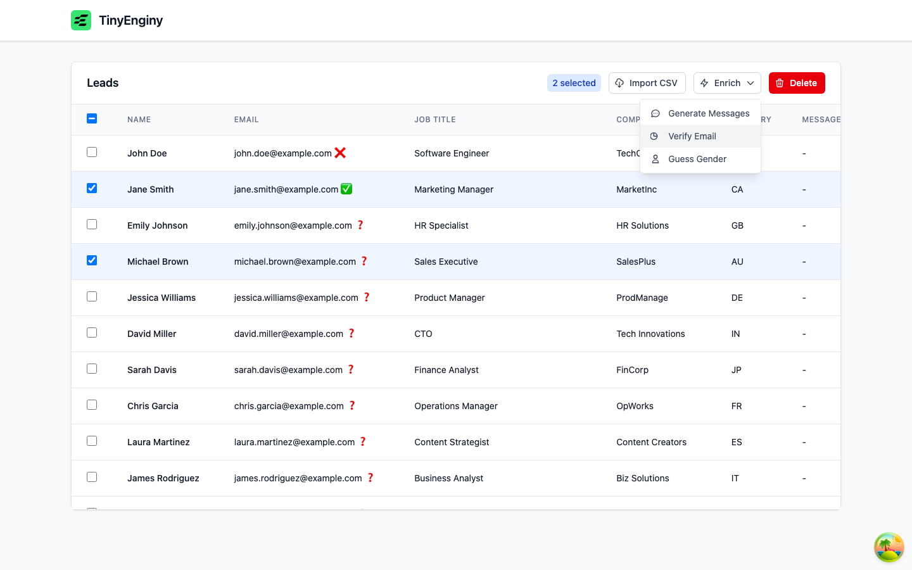
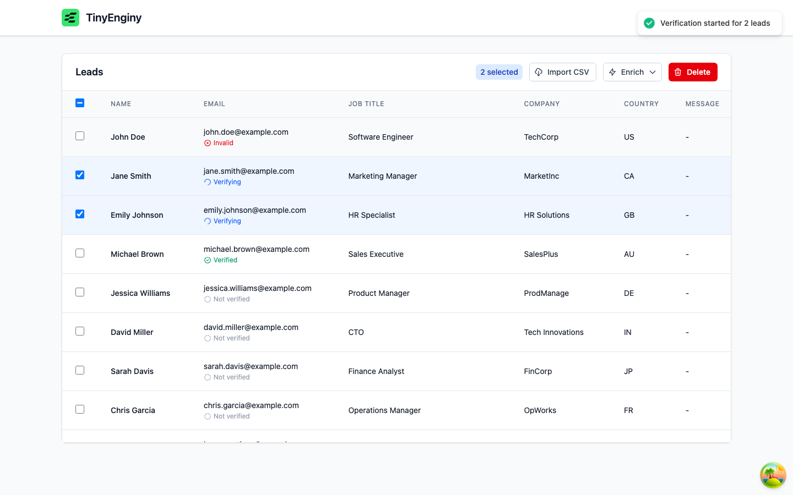
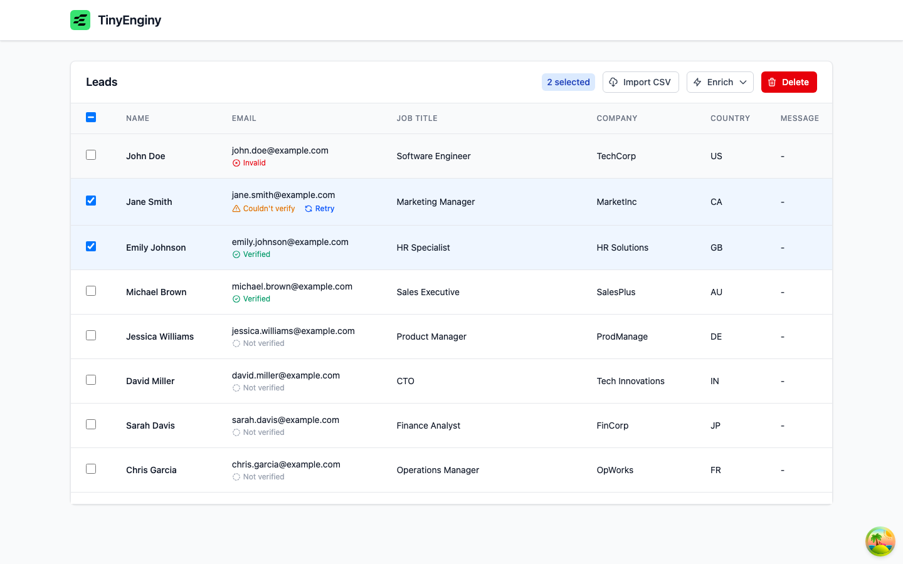
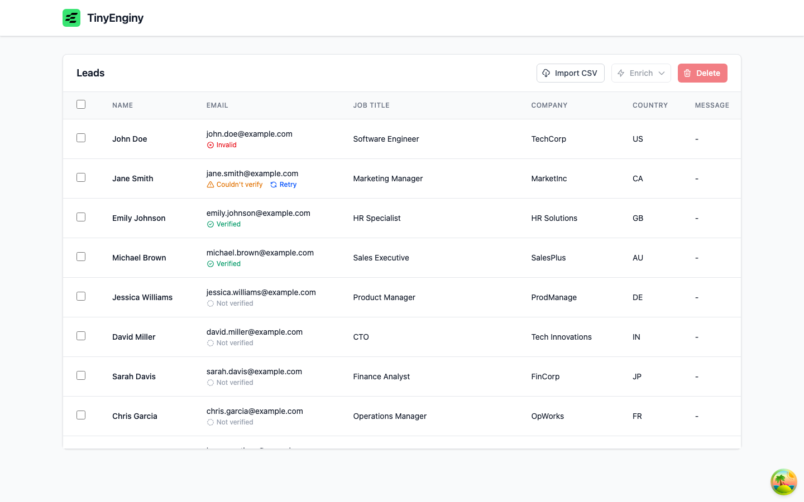

# FIX-002 - Email verification never finishes for some leads

| Field | Value |
| --- | --- |
| Fix ID | FIX-002 |
| OpenSpec change | [fix-email-verification-stall](../../openspec/changes/fix-email-verification-stall/proposal.md) |
| Capability | `email-verification` |
| Assessment findings | D1, A4, and A5 in [05-assessment.md](../architecture/05-assessment.md) |
| Status | Resolved |

## Symptom

Running "Verify Email" on some leads never reports success or failure, and the UI shows no progress.

## Reproduction

1. Start `temporal server start-dev`, the backend, and the frontend.
2. Select Jane Smith (`jane.smith@example.com`) and one other lead.
3. Open "Enrich" and click "Verify Email".
4. Wait more than one minute.

## Expected

The request returns quickly, each lead shows that verification is in progress, and each lead ends as verified, invalid, or failed.

## Actual

The request never completes, no toast appears, and neither lead's status changes.
The Temporal UI shows the `verifyEmail` activity timing out and retrying without end.

## Root cause

The `verifyEmail` activity has a one-second time limit and no retry policy, so the server default of unlimited retries applies.
The mock check for `jane.smith` takes 20 seconds, so every attempt times out and the workflow never finishes.
The API awaits each workflow result in sequence inside the HTTP request, so one stuck lead blocks the whole response.
The timed-out attempts cannot be cancelled, so each one keeps sleeping in the worker.

## Fix summary

Verification starts in the background and returns immediately, and each lead gets a stored status: unverified, pending, verified, invalid, or failed.
Attempts are limited to three with a five-second limit each, so a stuck check ends as failed in about 18 seconds.
The workflow records the outcome itself, one workflow runs per lead at a time, and the table polls while any lead is pending.
See the change's design.md for details.

## Evidence

### Reproduction (task 1.1)

Reproduced on 2026-10-30 with Playwright against `temporal server start-dev`, the backend, and the frontend, by selecting Jane Smith and Michael Brown and running Enrich, then Verify Email.

```text
BEFORE  Jane Smith       | jane.smith@example.com (verified in seed data)
BEFORE  Michael Brown    | michael.brown@example.com (unknown)
t=  8s pending=1 toasts=[] | no status change
...
t= 63s pending=1 toasts=[] | no status change
```

- The `POST /leads/verify-emails` request was still open after 63 seconds, with no toast and no status change.
- Michael Brown was never checked, because the handler awaits Jane Smith's workflow first.
- The Enrich menu stayed open with no progress indicator.
- The seed data already marks Jane Smith as verified, which hides the bug until verification runs again.

Temporal showed the activity retrying without limit:

```text
$ temporal workflow list
  Running  verify-email-2-1793351070291  verifyEmailWorkflow

$ temporal workflow describe -w verify-email-2-1793351070291
activity: verifyEmail | attempt: 8 | maximumAttempts: 0 (unlimited) | lastFailure: activity StartToClose timeout
```



### Verification after the fix (tasks 8.1 and 8.2)

Re-ran the scenario with Playwright against `temporal server start-dev` on 2026-10-30.
Michael Brown was already verified, because terminating the stuck workflow during the reproduction let the old request's loop continue, so Emily Johnson took his place.

```text
BEFORE  Jane Smith       | Verified
BEFORE  Emily Johnson    | Not verified
RESPONSE 202 after 63ms
t=  7s | Jane Smith: Verifying        | Emily Johnson: Verified
t= 17s | Jane Smith: Verifying        | Emily Johnson: Verified
t= 22s | Jane Smith: Couldn't verify  | Emily Johnson: Verified
```

- The request returned in 63 milliseconds, the toast read "Verification started for 2 leads", and the Enrich menu closed at once.
- Emily Johnson was verified within seconds, without waiting for Jane Smith.
- Jane Smith ended as "Couldn't verify" with a Retry button about 22 seconds after the start, inside the 30-second bound.





To check that outcomes do not depend on the client, the browser was closed right after clicking Retry for Jane Smith and reopened 30 seconds later.

```text
BEFORE   Couldn't verify Retry
STARTED  Verifying
CLOSED   browser, waiting 30s with no client open
REOPENED Couldn't verify Retry

$ temporal workflow list
  Completed  verify-email-2  verifyEmailWorkflow  35 seconds ago
  Completed  verify-email-2  verifyEmailWorkflow  1 minute ago
```

The second completed run of `verify-email-2` started and finished while no browser was open, and its outcome was shown on reopening.


